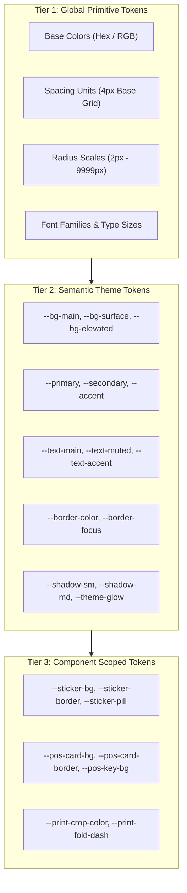

# PothHalaPro Design System Specification
**Version:** 2.0.0  
**Author:** UX/UI Design Systems Specialist  
**Target Environment:** Sri Lankan Bookshops, Communication Centers, Cyber Cafes & Education Studios  
**License:** Proprietary / Commercial Bookshop Suite  

---

## 1. Executive Summary & Design Philosophy

**PothHalaPro** is a mission-critical, hybrid-workstation software platform engineered for Sri Lankan retail bookshops, photocopy centers, and digital printing studios. The system bridges two high-stakes environments:
1. **High-Speed Counter POS & Touchscreen Kiosks**: Fast-paced retail counters handling cash transactions, high customer turnover, barcode scanning, and multi-service billing in Sri Lankan Rupees (LKR).
2. **Precision 1:1 Physical Millimeter Print Production**: Zero-distortion physical reproduction of ISO standard identity cards (Smart NIC, Classic NIC, Driving Licenses), 8-Up school name stickers, passport photo grids, and ESC/POS thermal receipts.

### Core Tenets

```
   ┌────────────────────────────────────────────────────────────────────────┐
   │                        POTTHALAPRO DESIGN TENETS                       │
   ├───────────────────┬───────────────────┬────────────────────────────────┤
   │ 1:1 TRUE PHYSICAL │ BILINGUAL HARMONY │ TACTILE COUNTER SPEED          │
   │ ZERO DISTORTION   │ SINHALA & ENGLISH │ RAPID TOUCH & SHORTCUTS        │
   │ Exact mm outputs  │ Modifier clearance│ 48px+ targets & single-tap POS │
   └───────────────────┴───────────────────┴────────────────────────────────┘
```

* **True 1:1 Scale Fidelity**: Every physical output must strictly match real-world millimeter dimensions with $\pm 0.1\text{ mm}$ tolerance. Laminated documents must fit standard lamination pouches without edge clipping or optical scaling distortion.
* **Bilingual Equality (සිංහල / English)**: Equal aesthetic and functional prominence for Sinhala Unicode scripts and English alphanumeric characters. Font stacks and line heights prevent clipping of Sinhala ascenders, descenders, and vowel modifiers.
* **Ambient Lighting & Kiosk Durability**: High-contrast visual tokens adapted for bright daylight, fluorescent tube lighting, and low-grade commercial TN/IPS counter monitors.
* **Touch-First Ergonomics**: Oversized touch targets (minimum $48\times 48\text{ px}$), high-contrast active touch states, and full keyboard shortcut parity for headless or touch-only operation.

---

## 2. Design Tokens Architecture

PothHalaPro utilizes a three-tier design token architecture implemented via CSS Custom Properties (`var(--token-name)`):



### 2.1 Primitive Spacing & Layout Scale (4px Base Grid)

| Token | Dimension (px) | Relative (rem) | Primary Application |
| :--- | :--- | :--- | :--- |
| `--space-1` | `4px` | `0.25rem` | Hairline padding, badge inner offsets |
| `--space-2` | `8px` | `0.5rem` | Compact button padding, grid gap tier 1 |
| `--space-3` | `12px` | `0.75rem` | Input field vertical padding, card spacing |
| `--space-4` | `16px` | `1.0rem` | Standard component margin, panel gutter |
| `--space-5` | `20px` | `1.25rem` | Card body padding, section header gaps |
| `--space-6` | `24px` | `1.5rem` | Viewport gutters, large card headers |
| `--space-8` | `32px` | `2.0rem` | Section separators, empty state margins |
| `--space-12` | `48px` | `3.0rem` | Touch button minimum hit zone |

---

### 2.2 Themes & Palette Matrix

PothHalaPro ships with 5 distinctive design themes tailored for diverse user demographics and store ambiances:

```
┌─────────────────────────────────────────────────────────────────────────────┐
│                              THEME PALETTE MATRIX                           │
├────────────────────┬───────────┬───────────┬───────────┬────────────────────┤
│ Theme Name         │ Primary   │ Secondary │ Accent    │ Surface Background │
├────────────────────┼───────────┼───────────┼───────────┼────────────────────┤
│ 1. Default Modern  │ #2563EB   │ #475569   │ #F59E0B   │ #F8FAFC / #FFFFFF  │
│ 2. Cyber Neon Kids │ #00F0FF   │ #A855F7   │ #39FF14   │ #0B0F19 / #111827  │
│ 3. Royal College   │ #B45309   │ #450A0A   │ #FACC15   │ #FAF5EF / #FFFFFF  │
│ 4. Kawaii Pink     │ #EC4899   │ #A855F7   │ #F472B6   │ #FFF5F7 / #FFFFFF  │
│ 5. Turbo Hero      │ #EA580C   │ #1C1917   │ #FACC15   │ #FFF8F1 / #FFFFFF  │
└────────────────────┴───────────┴───────────┴───────────┴────────────────────┘
```

#### Detailed Theme Profiles

1. **Default Modern Workstation (`:root`)**:
   * *Target*: Everyday commercial bookshop operations, high-efficiency counter clerks.
   * *Surfaces*: Pure White (`#FFFFFF`), Slate Clean Surface (`#F8FAFC`), Slate Subdued (`#F1F5F9`).
   * *Accents*: Sri Lanka Commercial Blue (`#2563EB`), Hover (`#1D4ED8`), LKR Amber (`#F59E0B`).
   * *Sidebar*: Deep Midnight Navy (`#0F172A`) with high-contrast text (`#F8FAFC`).

2. **Cyber Neon Kids (`[data-theme="cyber-neon"]`)**:
   * *Target*: Gaming internet cafes, tech-savvy students, modern digital studios.
   * *Surfaces*: Obsidian Cyber Matrix (`#0B0F19`), Night Surface (`#111827`), Card Void (`#1F2937`).
   * *Accents*: Electric Cyan Glow (`#00F0FF`), Neon Lime (`#39FF14`), Cyber Violet (`#7C3AED`).
   * *Special Attributes*: CSS glowing drop shadows (`0 0 16px rgba(0, 240, 255, 0.45)`).

3. **Royal College Gold (`[data-theme="royal-gold"]`)**:
   * *Target*: Prestige national schools, traditional educational institutes, official bookshops.
   * *Surfaces*: Antique Ivory Parchment (`#FAF5EF`), Warm Cream (`#FFFDF9`).
   * *Accents*: Imperial Collegiate Maroon (`#450A0A`), Burnished Academic Gold (`#EAB308`), Topaz (`#FACC15`).
   * *Typography*: Serif headings (`Georgia`, `Iskoola Pota`).

4. **Kawaii Pink & Lilac (`[data-theme="kawaii-pink"]`)**:
   * *Target*: Primary school sticker creation, kindergarten gift stationery, creative crafts.
   * *Surfaces*: Strawberry Milk Blush (`#FFF5F7`), Soft Marshmallow (`#FFFFFF`).
   * *Accents*: Candy Magenta (`#EC4899`), Pastel Lilac Blossom (`#C084FC`), Bubblegum (`#F472B6`).
   * *Borders & Radii*: Pillowy curved corners (`16px`–`24px`).

5. **Turbo Hero Orange (`[data-theme="turbo-hero"]`)**:
   * *Target*: High-energy sports sticker customization, motorsport themes, superhero fans.
   * *Surfaces*: Warm Asphalt (`#FFF8F1`), Carbon Charcoal (`#18181B`).
   * *Accents*: Blazing Turbo Orange (`#EA580C`), Racing Flame (`#F97316`), Motorsport Gold (`#FACC15`).

---

## 3. Bilingual Typography & Sinhala Font Standards

### 3.1 Cross-Platform Font Stacks

Sinhala typography requires strict cross-platform font fallbacks to guarantee crisp glyph shaping on Windows, macOS, Linux, and Android touchscreen tablets:

```css
/* Core Application Bilingual Stack */
--font-sans: system-ui, -apple-system, BlinkMacSystemFont, "Segoe UI", Roboto, 
             "Noto Sans Sinhala", "Iskoola Pota", "Nirmala UI", "Sinhala Sangam MN", 
             sans-serif;

/* Dedicated Sinhala Print & Canvas Rendering Stack */
--font-sinhala-print: "Noto Sans Sinhala", "Iskoola Pota", "Nirmala UI", "FMAbhaya", 
                      sans-serif;

/* POS Receipt Monospace Thermal Stack */
--font-mono-receipt: "Courier New", "Consolas", "Noto Sans Mono", monospace;
```

---

### 3.2 Sinhala Vowel Modifier (Kombuwa & Pillam) Protection Rules

A recurring defect in standard web typography is the vertical truncation of Sinhala vowel modifiers (පිල්ලම්) and diacritics when tight CSS line heights are applied. PothHalaPro enforces strict rendering rules:

```
     ┌────────────────────────────────────────────────────────┐
     │           SINHALA VOWEL MODIFIER CLEARANCE ZONE        │
     │                                                        │
     │   [Top Clearance 0.22em]                               │
     │   ▲   ්  (Al-lakuna)    ී  (Diga Ispilla)              │
     │   │   ි  (Keti Ispilla)                                │
     │ ──┼─────────────────────────────────────────────────── │
     │   │   ෙ   ක   ්   ෂ   ණ   ය                            │
     │ ──┼─────────────────────────────────────────────────── │
     │   │   ු  (Keti Papilla) ෲ  (Diga Gayanukitta)         │
     │   ▼   ූ  (Diga Papilla) ෟ  (Gayanukitta)               │
     │   [Bottom Clearance 0.22em]                            │
     └────────────────────────────────────────────────────────┘
```

#### Enforced Typography Constraints:

1. **Line Height Multipliers**:
   * Standard Body Text: Minimum `1.50` (`1.55` recommended for bilingual paragraphs).
   * Dense Tables & Data Grids: Minimum `1.45` (never drop below `1.40`).
   * Large Headlines: Minimum `1.28` with explicit `padding-top: 0.2em` and `padding-bottom: 0.2em`.

2. **Canvas High-Definition Rasterization (300 DPI)**:
   * When drawing Sinhala text onto an HTML5 Canvas for physical print output, text baseline must be set to `middle` or `alphabetic` with calculated metrics:
     ```javascript
     ctx.font = 'bold 38px "Noto Sans Sinhala", "Iskoola Pota", sans-serif';
     ctx.textBaseline = 'top';
     // Always reserve 12px vertical bounding box buffer above textY
     ```

3. **No Overflow Clipping on Text Containers**:
   * Never combine `overflow: hidden` on buttons or badges with Sinhala labels unless `padding: 4px 8px` is applied to shield Kombuwa (`ෙ`) and Ispilla (`ි`).

---

### 3.3 Typographic Scale Matrix

| Level | Size (Desktop) | Size (POS Touch) | Weight | Line Height | Usage Example |
| :--- | :--- | :--- | :--- | :--- | :--- |
| **Display** | `28px` / `1.75rem` | `32px` / `2.0rem` | `800` | `1.30` | Main Suite Branding, Total Due LKR |
| **H1** | `22px` / `1.375rem`| `24px` / `1.5rem`  | `700` | `1.35` | Module Headings (Smart NIC Studio) |
| **H2** | `18px` / `1.125rem`| `20px` / `1.25rem` | `600` | `1.40` | Card Headers, Dialog Titles |
| **H3** | `15px` / `0.937rem`| `17px` / `1.06rem` | `600` | `1.45` | Section Labels, Category Tabs |
| **Body** | `14px` / `0.875rem`| `15px` / `0.937rem`| `400 / 500`| `1.55` | Form Labels, Table Cells |
| **Caption** | `12px` / `0.75rem` | `13px` / `0.812rem`| `500` | `1.50` | Shortcut Hints (`[F2]`), Subtitles |
| **Micro** | `10px` / `0.625rem`| `11px` / `0.687rem`| `600` | `1.40` | Badge Tags, Thermal Disclaimers |

---

## 4. 1:1 True Physical Millimeter Dimensions & Calibration

### 4.1 Mathematical Calibration Foundation

To achieve zero optical distortion across consumer and commercial laser/inkjet printers, PothHalaPro operates on a dual-unit system:
* **CSS Physical Units (`mm`)**: Utilized in `@media print` stylesheets. Modern browser print engines map `1mm = 3.779527559px` at standard 96 CSS DPI.
* **Master High-Resolution Canvas Units (`300 DPI`)**: Utilized for offline image generation, PNG exports, and canvas drawing:
  $$\text{Scale Ratio} = \frac{300 \text{ dots}}{25.4 \text{ mm}} \approx 11.811023622 \text{ pixels per mm}$$

```
┌─────────────────────────────────────────────────────────────────────────────┐
│                 PHYSICAL DIMENSION & HIGH-DPI PIXEL MATRIX                  │
├─────────────────────────┬──────────────┬──────────────┬─────────────────────┤
│ Document / Item Type    │ Width (mm)   │ Height (mm)  │ 300 DPI Canvas (px) │
├─────────────────────────┼──────────────┼──────────────┼─────────────────────┤
│ ISO ID-1 Smart NIC / DL │ 85.60 mm     │ 54.00 mm     │ 1011 × 638 px       │
│ Classic Sri Lankan NIC  │ 100.00 mm    │ 65.00 mm     │ 1181 × 768 px       │
│ Postal Identity Card    │ 95.00 mm     │ 60.00 mm     │ 1122 × 709 px       │
│ 8-Up School Sticker     │ 90.00 mm     │ 45.00 mm     │ 1063 × 531 px       │
│ Passport Photo (8-Grid) │ 35.00 mm     │ 45.00 mm     │ 413 × 531 px        │
│ Full A4 Print Sheet     │ 210.00 mm    │ 297.00 mm    │ 2480 × 3508 px      │
│ 80mm Thermal Receipt    │ 72.00 mm (P) │ Dynamic      │ 576 px width (203DPI│
│ 58mm Thermal Receipt    │ 48.00 mm (P) │ Dynamic      │ 384 px width (203DPI│
└─────────────────────────┴──────────────┴──────────────┴─────────────────────┘
*(P) = Printable paper line width.*
```

---

### 4.2 Print Sheet Calibration & Finishing Standards

```
                      A4 SHEET PRINT SPECIFICATION (210mm x 297mm)
   ┌───┬─────────────────────────────────────────────────────────────────┬───┐
   │ ┌─┘ ◄── Precision Exterior Corner Crop Mark (5mm Hairline)        └─┐ │
   │ │                                                                   │ │
   │                                                                       │
   │       ┌─────────────────────────────────────────────────────┐         │
   │       │               ID CARD FRONT (85.60 x 54.00mm)       │         │
   │       └─────────────────────────────────────────────────────┘         │
   │  ► ─── - - - - - - CENTER FOLD SCORING AXIS - - - - - - - - - ◄ Spine │
   │       ┌─────────────────────────────────────────────────────┐  Notch  │
   │       │               ID CARD BACK  (85.60 x 54.00mm)       │         │
   │       └─────────────────────────────────────────────────────┘         │
   │                                                                       │
   │  ═══════════════════════════════════════════════════════════════════  │
   │  [0mm] | | | | [10mm] | | | | [20mm] | | | | [30mm] | | | | [50mm]    │
   │  ▲ 50.0mm Physical Verification Ruler (Check with Real Ruler)        │
   │ └─┐                                                               ┌─┘ │
   └───┴───────────────────────────────────────────────────────────────┴───┘
```

#### Critical Print Engine Rules:

1. **Page Geometry**:
   ```css
   @page {
     size: A4 portrait;
     margin: 0mm !important;
   }
   ```
2. **Exterior Corner Crop Marks**:
   * Crop marks must sit strictly *outside* the bounding box of the document to prevent hairline black borders on the final trimmed card.
   * Stroke width: `0.15mm` to `0.25mm` (`#1E293B`).
   * Length: `5.0mm` with a `1.5mm` offset from document corners.
3. **Back-to-Back Lamination Center Fold Guide**:
   * Features a dashed center scoring line (`border-top: 0.35mm dashed #1E293B`).
   * Dual side V-notches (`4mm × 2mm`) enabling operators to register the card crease instantly with a scoring tool or bone folder.
   * Bilingual directional indicators: `◀ FOLD HERE (නැමුම් රේඛාව) ✂`.
   * Enforces a minimum `3.0mm` clear pouch margin around all edges for airtight plastic bonding.
4. **Physical 50.0mm Verification Ruler**:
   * Every printed ID sheet includes a calibrated `50.0mm` verification bar at the bottom margin with single-millimeter tick marks. Operators verify scale accuracy in 2 seconds with an ordinary stationery ruler.

---

## 5. Component Standards & Interaction Architecture

### 5.1 Touchscreen Counter POS Interface

Designed for harsh, fast-paced retail counter environments where clerks handle cash, change, and queues:

```
┌─────────────────────────────────────────────────────────────────────────────┐
│                           COUNTER POS LAYOUT SCHEMA                         │
├──────────────────────────────────┬──────────────────────────────────────────┤
│ Category Tabs (Min 44px Height)  │ Cart Ledger & Real-Time Bill             │
│ [Copies] [Laminate] [Stickers]   ├──────────────────────────────────────────┤
├──────────────────────────────────┤ Line Items:                              │
│ Touch Item Cards (Min 82px)      │ • Photocopy A4 B&W (x2)  Rs. 30.00       │
│ ┌──────────────┐┌──────────────┐ │ • Smart NIC 1:1 Color    Rs. 150.00      │
│ │ A4 Color     ││ NIC 1:1 Print│ ├──────────────────────────────────────────┤
│ │ Rs. 60.00    ││ Rs. 150.00   │ │ Subtotal: Rs. 180.00  Discount: 0%       │
│ └──────────────┘└──────────────┘ │ Total Due: Rs. 180.00                    │
├──────────────────────────────────┼──────────────────────────────────────────┤
│ Quick Cash Tender Presets:       │ Integrated Kiosk Touch Numpad:           │
│ [Exact (Alt+E)] [+50] [+100]     │ [ 7 ] [ 8 ] [ 9 ] [ Clear ]              │
│ [+500] [+1000] [+5000]           │ [ 4 ] [ 5 ] [ 6 ] [   ⌫   ]              │
│ Tendered: Rs. 500  Change: Rs.320│ [ 1 ] [ 2 ] [ 3 ] [ Enter ]              │
└──────────────────────────────────┴──────────────────────────────────────────┘
```

* **Touch Targets**: All interactive elements exceed $48\times 48\text{ px}$. Item cards are $82\text{ px}$ tall to accommodate thumbs without mis-taps.
* **Instant Tactile Feedback**:
  * Tap down: `transform: scale(0.97)` with immediate highlight.
  * Numbered hotkey badges: Top-right shortcut tags `[1]` through `[6]` for instant 1-key item entry.
* **Quick Cash Tender Buttons**: Single-tap tender calculations (`Exact [Alt+E]`, `+Rs. 50`, `+Rs. 100`, `+Rs. 500`, `+Rs. 1,000 [Alt+T]`, `+Rs. 5,000`) displaying change in giant 24px bold emerald text (`Rs. XXX.XX`).

---

### 5.2 8-Up School Name Sticker Studio

* **Sheet Layout**: 8 stickers arranged in 2 columns of 4 rows on an A4 sheet.
* **Individual Sticker Geometry**: Exactly $90.00\text{ mm} \times 45.00\text{ mm}$ with rounded $3.5\text{ mm}$ die-cut corners.
* **Automation Features**:
  * 1-Click curriculum subject loader (Sinhala & English) for Grades 1–13.
  * Auto-generation of 8 individual subjects (e.g., ගණිතය, සිංහල, විද්‍යාව, බුද්ධ ධර්මය).
  * Avatar customizer featuring 12 built-in cartoon assets + custom student photo upload.

---

## 6. Vector Cartoon Asset Library Specification

PothHalaPro incorporates a dedicated vector illustration library designed specifically for school name stickers, student ID labels, and education hub worksheets.

### 6.1 Vector Asset Specifications

* **ViewBox Standard**: `0 0 120 120` (Square aspect ratio $1:1$).
* **Geometry**: Contained within a circular background badge ($\text{radius } r=56\text{ at } cx=60, cy=60$).
* **Scalability Range**: Seamless rendering from $32\text{ px}$ (touchpicker preview) to $300\text{ DPI}$ physical sticker print ($1063 \times 531\text{ px}$ canvas).
* **Color Compatibility**: Calibrated to match the 5 UI themes without color clashes.

```
┌─────────────────────────────────────────────────────────────────────────────┐
│                       VECTOR CARTOON ASSET CATALOG                          │
├────┬─────────────────┬──────────────────────────┬───────────────────────────┤
│ #  │ File Name       │ Character & Description  │ Dominant Palette          │
├────┼─────────────────┼──────────────────────────┼───────────────────────────┤
│ 1  │ superhero.svg   │ Flying Caped Superhero   │ Royal Blue, Red, Yellow   │
│ 2  │ astronaut.svg   │ Cosmic Space Explorer    │ Deep Navy, Cyan, White    │
│ 3  │ princess.svg    │ Royal Crowned Princess   │ Soft Pink, Lilac, Gold    │
│ 4  │ racing_car.svg  │ Formula Speed Racer #1   │ Crimson Red, Charcoal     │
│ 5  │ robot.svg       │ High-Tech Friendly Bot   │ Sky Blue, Emerald, Slate  │
│ 6  │ dinosaur.svg    │ Playful T-Rex Dino       │ Mint Green, Amber, Orange │
│ 7  │ scholar.svg     │ Graduate with Cap/Glasses│ Golden Amber, Slate Navy  │
│ 8  │ lion_mascot.svg │ Courageous Lion Cub      │ Warm Ochre, Gold, Amber   │
│ 9  │ teacher.svg     │ Smiling Teacher & Chalk  │ Emerald Green, Slate, Gold│
│ 10 │ doctor.svg      │ Friendly Doctor & Stetho │ Sky Blue, White, Crimson  │
│ 11 │ sports_star.svg │ Champion Athlete #1      │ Royal Blue, Gold, Red     │
│ 12 │ space_rocket.svg│ Soaring Blastoff Rocket  │ Midnight Void, Flame Red  │
└────┴─────────────────┴──────────────────────────┴───────────────────────────┘
```

---

### 6.2 Detailed Breakdown of Newly Added Cartoon Assets

#### 1. `teacher.svg` (The Dedicated Educator)
* **Visual Story**: A warm, approachable school teacher holding an open textbook in front of a green chalkboard inscribed with `"A B C"` and `"1 2 3"`.
* **Design Elements**: Round emerald spectacles, neat attire, cheerful facial expression, book with text lines, and background chalkboard with dashed chalk line.
* **Target Audience**: Primary school students, scholarship exam candidates, classroom subject books.
* **Color Tokens**:
  * Background: `#D1FAE5` (Emerald Tint)
  * Chalkboard: `#064E3B` / `#065F46` (Forest Green)
  * Attire: `#059669` (Scholastic Emerald)
  * Spectacles & Accents: `#047857`, `#FDE047`

#### 2. `doctor.svg` (The Healthcare Hero)
* **Visual Story**: A reassuring, cheerful doctor wearing a crisp white clinical coat, stethoscope draped around the neck, blue scrubs, and a medical forehead reflector.
* **Design Elements**: Prominent red cross medical emblem badge, realistic dual-tube stethoscope with acoustic chest piece, shirt pocket with diagnostic pens.
* **Target Audience**: Science stream students, future medical aspirants, health science exercise books.
* **Color Tokens**:
  * Background: `#E0F2FE` (Clinical Light Blue)
  * Coat & Scrub: `#F8FAFC` (Pure White) / `#0284C7` (Medical Blue)
  * Cross & Accents: `#EF4444` (Emergency Red) / `#38BDF8` (Cyan)

#### 3. `sports_star.svg` (The Champion Athlete)
* **Visual Story**: A vibrant, determined school athlete wearing a #1 champion jersey, athletic headband, victorious gold medal, and soccer/cricket sports ball.
* **Design Elements**: Star sparkles in background, gold medal with crimson ribbon, bold athletic typography `"1"`, energetic winner smile.
* **Target Audience**: School sports house teams, physical education books, cricket & football club players.
* **Color Tokens**:
  * Background: `#FEF3C7` (Championship Warm Gold)
  * Jersey: `#2563EB` (Victory Royal Blue)
  * Medal & Trim: `#F59E0B` / `#FACC15` (Imperial Gold)
  * Headband & Ribbon: `#DC2626` (Passionate Red)

#### 4. `space_rocket.svg` (Cosmic Exploration)
* **Visual Story**: An aerodynamic rocket ship blasting off into deep space, propelled by radiant flame exhaust and surrounded by cosmic stellar sparkles.
* **Design Elements**: Sleek fuselage with red nosecone, aerodynamic stabilizer booster fins, circular porthole with light refraction, three-tone fiery exhaust plume.
* **Target Audience**: Science, technology, astronomy, mathematics, and adventure lovers.
* **Color Tokens**:
  * Background: `#0F172A` (Deep Cosmic Navy)
  * Fuselage: `#F8FAFC` (Space White) / `#DC2626` (Rocket Red)
  * Exhaust Plume: `#FACC15` (Yellow Core) $\rightarrow$ `#F97316` (Orange) $\rightarrow$ `#EF4444` (Outer Blast)
  * Porthole: `#0284C7` with `#BAE6FD` reflection

---

## 7. Global Keyboard Shortcut Standards

For rapid counter operation without mouse reliance, PothHalaPro assigns global function keys:

```
┌─────────────────────────────────────────────────────────────────────────────┐
│                          GLOBAL KEYBOARD SHORTCUTS                          │
├───────────────┬────────────────────────────┬────────────────────────────────┤
│ Shortcut Key  │ Target Action              │ Operational Scope              │
├───────────────┼────────────────────────────┼────────────────────────────────┤
│ [F1] / [?]    │ Shortcuts Help Modal       │ Global Cheat Sheet             │
│ [F2]          │ Smart NIC & License Cloner │ Switch to Module 1             │
│ [F3]          │ School Sticker Studio      │ Switch to Module 2             │
│ [F4]          │ Counter POS & Quick Bill   │ Switch to Module 3             │
│ [F6]          │ Education Hub & Papers     │ Switch to Module 4             │
│ [F7]          │ Business Analytics         │ Switch to Module 5             │
│ [F8]          │ System Settings & License  │ Switch to Module 6             │
│ [Ctrl + P]    │ Print Production Sheet     │ Current Active Module          │
│ [Ctrl + Enter]│ Complete Sale & Print POS  │ Counter POS Billing            │
│ [Alt + E]     │ Tender Exact Amount        │ Counter POS Billing            │
│ [Alt + T]     │ Tender Rs. 1,000 Note      │ Counter POS Billing            │
│ [Alt + C]     │ Clear Bill / Reset Cart    │ Counter POS Billing            │
│ [1] - [6]     │ Fast Add Item 1 - 6        │ Counter POS Item Grid          │
│ [Esc]         │ Close Modal / Cancel View  │ Global Dialog Controller       │
└───────────────┴────────────────────────────┴────────────────────────────────┘
```

---

## 8. WCAG 2.1 Accessibility & Environmental Durability

1. **Color Contrast Ratios**:
   * Text Elements: All body text and pricing figures maintain a minimum contrast ratio of `7:1` against their backgrounds, exceeding WCAG AAA standards.
   * UI Controls: Touch buttons and borders maintain at least `4.5:1` contrast against surrounding surfaces.
2. **Anti-Glare High Brightness Mode**:
   * The `Default Modern` and `Royal Gold` themes utilize warm high-value surfaces to remain legible under direct 5800K fluorescent shop lighting without optical eye fatigue.
3. **Keyboard & Touch Redundancy**:
   * Zero functionality is locked behind pointer-hover states. Every action has an explicit click/tap trigger and an accompanying keyboard shortcut.

---

## 9. File Directory Architecture

```
PothHalaPro/
├── DESIGN_SYSTEM.md                  ◄ [This Specification Document]
├── public/
│   ├── assets/
│   │   ├── cartoons/                 ◄ Vector Illustration Library (120x120)
│   │   │   ├── superhero.svg
│   │   │   ├── astronaut.svg
│   │   │   ├── princess.svg
│   │   │   ├── racing_car.svg
│   │   │   ├── robot.svg
│   │   │   ├── dinosaur.svg
│   │   │   ├── scholar.svg
│   │   │   ├── lion_mascot.svg
│   │   │   ├── teacher.svg          ◄ [New Asset]
│   │   │   ├── doctor.svg           ◄ [New Asset]
│   │   │   ├── sports_star.svg      ◄ [New Asset]
│   │   │   └── space_rocket.svg     ◄ [New Asset]
│   │   └── samples/
│   ├── css/
│   │   ├── style.css                 ◄ Global UI & Responsive Architecture
│   │   ├── print.css                 ◄ 1:1 True Physical Millimeter Print Engine
│   │   └── themes.css                ◄ Theme Tokens & Color Systems
│   ├── js/
│   │   ├── app.js                    ◄ Application Orchestration & Shortcuts
│   │   ├── nic-cloner.js             ◄ 1:1 Scale NIC & License Calibration
│   │   ├── sticker-studio.js         ◄ 8-Up Sticker Studio & Cartoon Engine
│   │   ├── counter-tools.js          ◄ Touchscreen POS & Thermal Billing
│   │   ├── education-hub.js          ◄ Curriculum & Past Papers
│   │   ├── license.js                ◄ Cryptographic Offline Activation
│   │   └── storage.js                ◄ Offline IndexedDB Ledger
│   └── sw.js                         ◄ Service Worker Offline Pre-caching
```

---
*Co-authored-by: OpenBot <335604065+openbotgit[bot]@users.noreply.github.com>*
